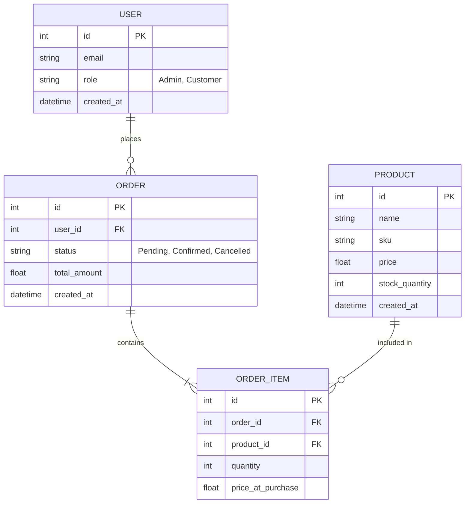

# Специфікація архітектури (Inventory & Order Management API)

## 1. Загальний опис
Проєкт є RESTful API для управління запасами на складі та оформлення замовлень клієнтами. Головна мета архітектури - забезпечити строгу консистентність даних при одночасних покупках (вирішення проблеми race conditions при списанні залишків).

## 2. Розбиття на модулі

Система побудована за модульним принципом. Кожен модуль відповідає за свою частину бізнес-логіки.

| Модуль | Зона відповідальності | Залежності |
|---|---|---|
| **Inventory** | Управління товарами (`Product`) та їхніми залишками (`stock_quantity`). Надає метод для блокування/списання товару. | Не залежить від інших бізнес-модулів. |
| **Orders** | Обробка замовлень клієнтів (`Order`, `OrderItem`). Керує життєвим циклом замовлення (створення, оплата, скасування). | Залежить від `Inventory` (перевірка залишків) та `Users` (ідентифікація клієнта). |
| **Users** | Авторизація, зберігання профілів клієнтів та адміністраторів. | Не залежить від інших модулів. |

## 3. Дані та зв'язки (ER-Діаграма)

## 4. Ключові сценарії (Як оновлюються дані)
### Сценарій: Оформлення замовлення (Data Update Flow)
Коли клієнт намагається купити товар, система повинна гарантувати, що товар дійсно є на складі і ніхто інший його не перехопив у ту саму мілісекунду.

Кроки взаємодії модулів:
1. Ініціалізація: Клієнт відправляє запит у модуль Orders (масив ID товарів та їхня кількість).
2. Транзакція БД: Відкривається єдина транзакція бази даних.
3. Запит до складу: Orders викликає метод Inventory.reserveStock(items).
4. Блокування та перевірка: Модуль Inventory перевіряє stock_quantity. Якщо залишку достатньо:

    - Значення stock_quantity зменшується.

    - Якщо залишку не вистачає, транзакція відкидається (Rollback), клієнт отримує помилку.
5. Створення замовлення: Модуль Orders створює запис у таблиці ORDER зі статусом Confirmed та додає відповідні ORDER_ITEM.
6. Завершення: Транзакція комітиться (Commit).

Цей підхід (ACID транзакції) гарантує, що неможливо створити замовлення без фактичного зменшення товару на складі.